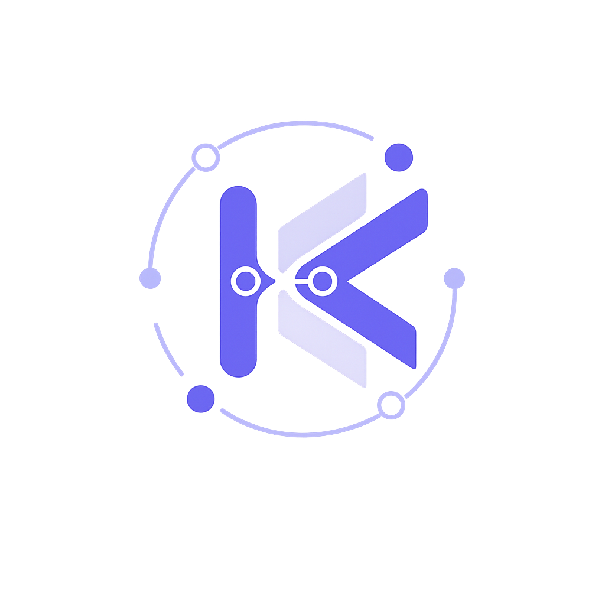
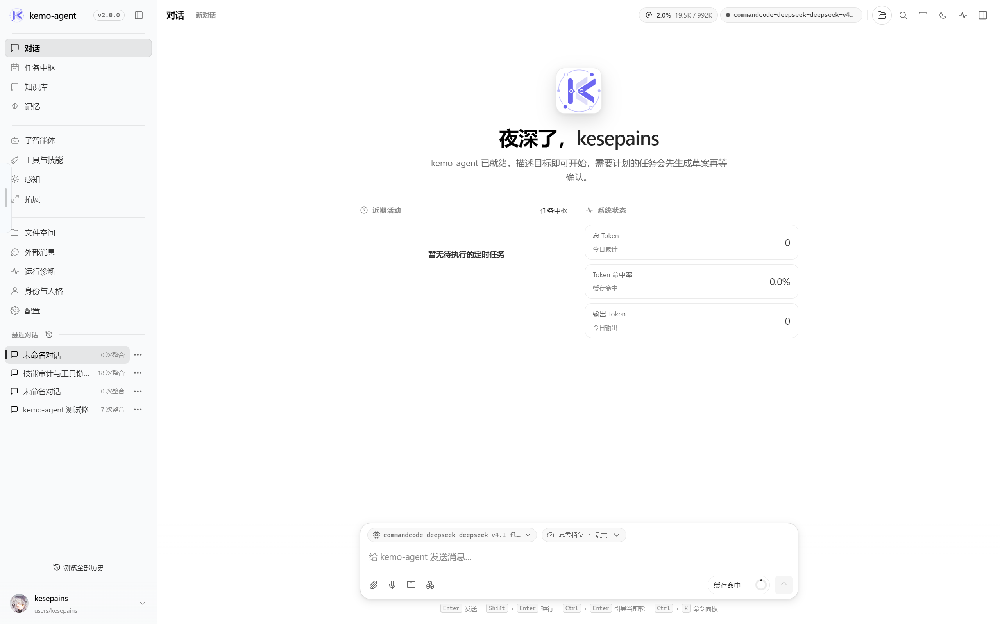

# kemo-agent

<p align="center">
  
</p>

<p align="center">
  <a href="readme.md">简体中文</a> · <strong>English</strong>
</p>

<p align="center">
  <strong>A local multi-user Agent Runtime for the next generation of personal intelligence infrastructure.</strong>
</p>

<p align="center">
  Built around the Kemo Tidal Engram lifecycle memory system, kemo-agent orchestrates context, subagents, tools, environmental perception, external extensions, and cross-platform interaction,<br>
  enabling agents to develop long-term cognition, evolve continuously, schedule complex work, and connect with the real world.
</p>

<p align="center">
  <a href="https://github.com/kesepain-KE/kemo-agent"></a>
  <a href="LICENSE"></a>
  <a href="https://kesepain-ke.github.io/kemo-agent-doc/"></a>
</p>

> Want to get it running? [Jump to quick start](#quick-start)

---

## What if every conversation did not have to start over?

Many AI assistants exist only inside the current window.

Close the window, and the relationship resets. Your preferences, ongoing work, previous decisions, and the details you repeatedly emphasized may all disappear by the next time you meet.

kemo-agent is trying to build a different kind of agent.

It does not treat every exchange as an isolated question and answer. Instead, it connects the time you spend together into a continuous line. A goal discussed today can continue tomorrow. A plan left weeks ago can resurface when it becomes relevant. Information that truly matters can gradually become part of the context through which the agent understands you.

It is more than a window that answers questions. It is closer to a personal intelligence workspace that you control.

---

## Memory moves like the tide

Human memory is not a warehouse filled with untouched records.

Some words matter only in the moment and quietly fade as the tide recedes. Some things are mentioned again and again, leaving clearer traces with every rise and fall. Other people and decisions remain worth remembering even after a long time.

That is the experience **Kemo Tidal Engram** is designed to create.

kemo-agent does not try to remember everything mechanically. Over long-term use, it attempts to distinguish what relates to you, what still matters, and what should return at the right moment.

You always retain the ability to inspect, supplement, and correct its memories. Memory is not a hidden black-box judgment; it is something you and the agent maintain together.

> The tide carries brief echoes away, but leaves what truly matters on the shore.

---

## What can it help you do?

| Scenario | What kemo-agent provides |
|---|---|
| Everyday conversation | Continue with your communication style, preferences, and long-term interests without repeatedly explaining the background |
| Memory consolidation | Let important information remain, reinforce what is repeatedly mentioned, and allow outdated details to fade quietly |
| Complex tasks | Turn an ambiguous goal into a clear plan and keep track of its steps and results |
| Long-running projects | Preserve key decisions, unfinished work, and phase changes so work can resume at any time |
| Scheduled assistance | Execute tasks, organize information, or send reminders at an agreed time, even while you are offline |
| Knowledge collaboration | Work with personal or team materials so responses stay grounded in the real working environment |
| Deeper reasoning | Spend more effort on difficult problems while responding quickly to simple ones |
| Subagent collaboration | Delegate memory organization, planning, scheduling, and other specialized judgments to focused subagents |
| External access | Stay connected to the same agent through the web, command line, or messaging platforms |
| File exchange | Receive user materials and organize generated results and temporary files |
| Environmental awareness | Combine authorized information sources so the agent can understand its current environment |
| Extensible capabilities | Add tools, skills, perception sources, and external integrations as needed |

These capabilities are not isolated feature entries. They serve one shared goal: helping the agent understand what is happening and keep work moving forward.

---

## A complete personal intelligence workspace

The kemo-agent web interface is organized around real workflows rather than a single input box.

From one place, you can:

- hold streaming conversations and add text, image, audio, video, or file guidance while a run is in progress;
- search, switch, save, and manage conversation history;
- inspect and edit memories to maintain long-term cognition;
- manage personal, shared, and global knowledge;
- create, approve, pause, and resume task plans;
- schedule one-time or recurring tasks;
- inspect tools, skills, perception sources, and extension capabilities;
- manage uploaded files, generated outputs, and temporary content;
- check external messaging connections and current runtime status;
- keep separate data and workspaces for different users.

Even very long conversations do not require loading the entire history at once. The web interface displays recent content first and loads older messages when you scroll upward, keeping long-running conversations lightweight.

<p align="center">
  
</p>

---

## The same agent through more than one interface

You can have an extended conversation in the browser, handle local work quickly from the command line, or send a message from a connected messaging platform.

The interface may change, but the user identity, conversation history, memories, and authorized resources still belong to the same person. kemo-agent aims to reduce the fragmentation of having to “meet again” whenever you switch platforms, allowing the agent to become a persistent personal interface.

Scheduled tasks are part of that continuity as well. While you are offline, the agent can wake at an agreed time, complete the work entrusted to it, and leave behind a result you can review later.

---

## Complex work can be completed gradually

When a goal requires multiple steps, kemo-agent can confirm a plan with you before taking action.

You can see where the task is, what has been completed, and what remains. You can also pause midway, reconsider the direction, and decide whether to continue.

The emphasis is not on uncontrolled “full automation,” but on a collaboration process that remains understandable, interruptible, and resumable.

Some work should be completed immediately, some needs several rounds of interaction, and some belongs at a future time. kemo-agent is designed to let all three rhythms coexist naturally in one workspace.

---

## Your data should remain under your control

kemo-agent is local-first.

Conversations, memories, knowledge, tasks, and user files are managed in your workspace, where they can be inspected, backed up, and migrated. Different users remain clearly separated, and each user controls which resources may be used.

The project does not claim that every model service is inherently private. What is sent to an external service depends on the provider, configuration, and authorization scope you choose. kemo-agent's role is to return as much choice and visibility to the user as possible.

---

## Quick start

```powershell
# Windows (requires Python 3.10+)
irm https://raw.githubusercontent.com/kesepain-KE/kemo-agent/main/deploy/windows/install.ps1 | iex
& "$env:USERPROFILE\.kemo-agent\deploy\deploy.cmd" start
```

Open http://127.0.0.1:1357. On first launch, you will be guided through model-service and user configuration.

Other methods: [Linux](https://kesepain-ke.github.io/kemo-agent-doc/guide/installation#linux) ·
[npm](https://kesepain-ke.github.io/kemo-agent-doc/guide/installation#npm) ·
[Docker](https://kesepain-ke.github.io/kemo-agent-doc/guide/installation#docker) ·
[Source](https://kesepain-ke.github.io/kemo-agent-doc/guide/installation#源码安装) ·
[Full installation guide](https://kesepain-ke.github.io/kemo-agent-doc/guide/installation) (in Chinese).

---

## What we want it to become

kemo-agent is not trying to become an omnipotent system that makes every decision for the user.

It aims to become a stable foundation for personal intelligence:

- the longer you work together, the better it understands your habits and boundaries;
- before tackling complex work, it reaches an agreement with you;
- when action is needed, it shows the process and result clearly;
- when work must wait, it remembers to continue in the future;
- capabilities can grow while control remains with the user;
- your data can remain even when you change models or connection methods.

A genuinely long-term intelligent relationship should not depend on one impressive answer. It should emerge from countless instances of reliable, restrained, and continuous collaboration.

---

## Current status

Current version: `2.0.0`, compatible with Kemo gateway `1.0.0`.

2.0.0 is a breaking update: CardStream, YAML configuration and module hot loading, and path-based knowledge libraries.
See [Releases](https://github.com/kesepain-KE/kemo-agent/releases)
and the [documentation site](https://kesepain-ke.github.io/kemo-agent-doc/) for the full changes and feature list.

---

## The Kemo ecosystem

kemo-agent is not an island. Around it, several independently maintained projects cooperate through stable protocols to form the Kemo ecosystem:

- [kemo-adapter-api](https://github.com/kesepain-KE/kemo-adapter-api)
  Kemo Provider Gateway: the compatibility baseline is `1.0.0`, using the verified Kemo 2.0 wire protocol. It provides unified multi-provider model discovery, streaming responses, tool calls, capability declarations, multimodal assets, and token metering, giving kemo-agent a consistent model-service boundary.

- [kemo-graph](https://github.com/kesepain-KE/kemo-graph)
  A knowledge-graph and RAG retrieval project that can be attached to kemo-agent as an external document station: after registering a document library, you query, sync, and maintain it on demand through `expand_call`, without replacing the framework's built-in knowledge base or memory.

- [kemo-agent-app](https://github.com/kesepain-KE/kemo-agent-app)
  The Android client of the kemo ecosystem: after connecting to a deployed kemo-agent and Kemo gateway, conversations, tasks, files, extension perception, runtime status, and agent configuration can all continue on your phone. It communicates through the `kemo_app` bridge inside kemo-agent (HTTP/SSE/WebSocket) with two-level authentication and transport.

- [kemo-agent-doc](https://github.com/kesepain-KE/kemo-agent-doc)
  The VitePress documentation site for kemo-agent: installation, configuration, usage, and extension development guides, deployed as [online documentation](https://kesepain-ke.github.io/kemo-agent-doc/).

### Other projects

- [votx-agent](https://github.com/kesepain-KE/votx-agent)
  An independently maintained Agent project with no inheritance relationship to kemo-agent.

---

## Maintainer

[@kesepain](https://github.com/kesepain-KE)

---

## Contributing

kemo-agent is still at a very early stage. Bug reports, usability feedback, documentation improvements, and code contributions are all welcome.

If you are trying an early release, reports about problems, usability feedback, and the work you genuinely want an agent to take on are all welcome.

Recommended workflow:

1. Fork this repository.
2. Create a feature branch.
3. Make the change and perform the necessary verification.
4. Open a Pull Request explaining what changed and why.

---

## License

This project is licensed under the [Apache License 2.0](LICENSE).
