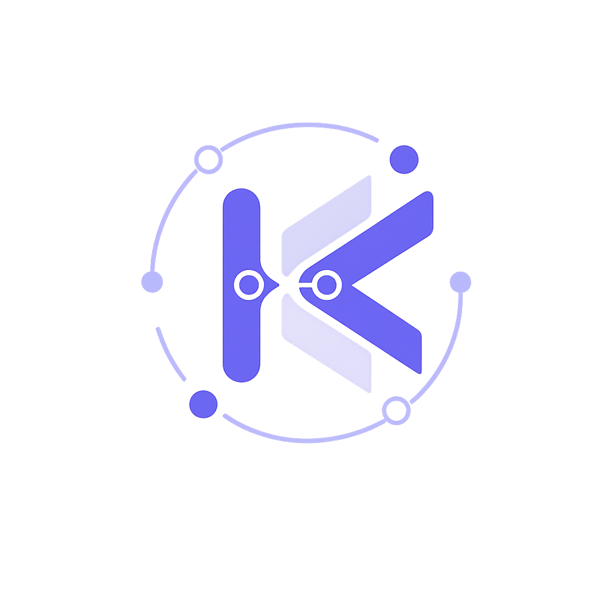
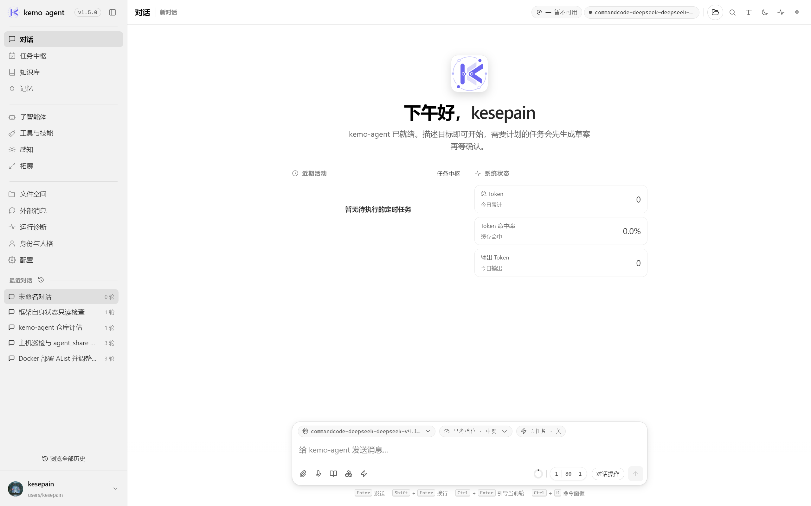

# kemo-agent

<p align="center">
  
</p>

<p align="center">
  <strong>简体中文</strong> · <a href="README_EN.md">English</a>
</p>

<p align="center">
  <strong>面向新一代个人智能基础设施的本地多用户 Agent Runtime。</strong>
</p>

<p align="center">
  以 Kemo Tidal Engram 潮汐式生命周期记忆系统为核心，统一编排上下文、子代理、工具、环境感知、外部扩展与跨平台交互，<br>
  使智能体具备长期认知、持续演化、复杂任务调度与现实世界连接能力。
</p>

<p align="center">
  <a href="https://github.com/kesepain-KE/kemo-agent"></a>
  <a href="LICENSE"></a>
  <a href="https://kesepain-ke.github.io/kemo-agent-doc/"></a>
</p>

---

## 如果每次对话都不必重新认识

很多智能助手只存在于当前窗口。

窗口关闭，关系也随之归零。你的偏好、正在推进的事情、曾经做过的决定，以及那些反复强调的重要细节，都可能在下一次见面时失去踪迹。

kemo-agent 想做另一种智能体。

它不把每次交流视为孤立的问答，而是把与你相处的时间连成一条延续的线。今天讨论过的目标，可以在明天继续；几周前留下的计划，可以在需要时重新被提起；那些真正重要的信息，会逐渐成为它理解你的背景。

它不是只会回答问题的窗口，更像是一间由你掌管的个人智能工作空间。

---

## 记忆如潮

人的记忆从来不是一座堆满原始记录的仓库。

有些话只在当时重要，潮水退去后便安静淡出；有些事情被反复提起，在一次次涨落中留下更清晰的痕迹；还有一些人与决定，即使经过很久，也依然值得被认真记住。

这正是 **Kemo Tidal Engram（潮汐记忆）** 想带来的体验。

kemo-agent 不追求机械地记住一切，而是希望在漫长的使用过程中，逐渐分辨什么与你有关、什么仍然重要、什么应当在恰当的时候重新浮现。

你也始终拥有查看、补充和修正记忆的权利。记忆不是隐藏在黑箱里的判断，而是你与智能体共同维护的一部分。

> 潮汐会带走短暂的回声，也会把真正重要的东西留在岸上。

---

## 它可以陪你做什么

| 场景 | kemo-agent 带来的体验 |
|---|---|
| 日常交流 | 延续你的表达习惯、偏好与长期关注点，不必反复交代背景 |
| 记忆沉淀 | 重要的信息自然留存、反复提及的加深印象、不再需要的安静淡出 |
| 复杂任务 | 把模糊目标整理为清晰计划，持续跟进步骤与结果 |
| 长期项目 | 保留关键决定、未完成事项与阶段变化，随时接续工作 |
| 定时守候 | 在约定时间执行任务、整理信息或发送提醒，你不在线时也会按时醒来 |
| 知识协作 | 使用属于个人或团队的资料，让回答贴近真实工作环境 |
| 深度思考 | 面对复杂问题时自动投入更多思考，简单问题则快速响应 |
| 子代理协作 | 把整理记忆、规划步骤、定时调度等专门判断交给擅长的子代理处理 |
| 外部连接 | 从网页、命令行或消息平台与同一位智能体保持联系 |
| 文件往来 | 接收用户资料，整理智能体生成的结果与临时文件 |
| 状态感知 | 汇集已授权的信息来源，让智能体了解当下环境 |
| 能力扩展 | 按需要增加新的工具、技能、感知来源与外部连接 |

这些能力并不是彼此孤立的功能入口。它们共同服务于同一个目标：让智能体能够理解正在发生什么，并把事情持续向前推进。

---

## 一处完整的个人智能工作台

kemo-agent 的网页端围绕真实使用过程组织，而不是只提供一个输入框。

你可以在其中：

- 与智能体进行流式对话，并在运行过程中追加文本、图片、音频、视频或文件引导；
- 搜索、切换、保存和管理历史对话；
- 查看与编辑记忆，维护长期认知；
- 管理个人、共享与全局知识；
- 创建、批准、暂停和继续任务计划；
- 安排一次性或周期性的定时任务；
- 查看工具、技能、感知来源与扩展能力；
- 管理上传文件、生成结果与临时内容；
- 检查外部消息连接和当前运行状态；
- 为不同用户保留彼此独立的资料与工作空间。

对话再长，也不需要一次加载全部历史。网页只呈现最近的内容，需要回顾时再向上加载，让长期交流保持轻盈。

<p align="center">
  
</p>

---

## 同一个智能体，不止一个入口

你可以在浏览器里与它长谈，也可以在命令行中快速处理本地事务，或从已经连接的消息平台发来一句话。

入口可以改变，但用户身份、历史关系、记忆与已授权资源仍然属于同一个人。kemo-agent 希望减少“换个平台就要重新认识一次”的割裂感，让智能体真正成为一个持续存在的个人入口。

定时任务同样属于这段连续关系。你不在线时，它仍可以在约定时间醒来，完成被托付的事情，并留下可回看的结果。

---

## 复杂的事情，也可以慢慢完成

面对多步骤目标，kemo-agent 可以先与你确认计划，再开始行动。

你能够看到任务正在推进到哪里、已经完成了什么、还剩下什么；也可以在执行途中暂停，重新考虑方向，再决定是否继续。

它强调的不是脱离用户控制的“全自动”，而是可理解、可干预、可继续的协作过程。

有些事情适合当场完成，有些事情需要跨越多轮交流，还有些事情应当留给未来某个时间。kemo-agent 尝试让这三种节奏自然地存在于同一处工作空间中。

---

## 属于你的数据，也应当由你掌管

kemo-agent 坚持本地优先。

对话、记忆、知识、任务与用户文件由你的工作空间管理，可以查看、备份和迁移。不同用户之间保持清晰边界，哪些资源能够被使用，也由用户自己决定。

项目不会承诺任何模型服务都天然私密。实际发送给外部服务的内容取决于你选择的服务、配置与授权范围。kemo-agent 所做的是把选择权和可见性尽可能交还给使用者。

---

## 开始体验

> 📖 完整的安装、配置、功能使用和扩展开发说明，请访问 **[kemo-agent 在线文档](https://kesepain-ke.github.io/kemo-agent-doc/)**。

### 选择安装方式

Windows、Linux、npm 和 Docker 共用主框架版本。当前正式定档版本为 **1.5.2**，网关兼容基线为 **1.0.0**。

> **发布前提：** 以下远程命令仅在安装脚本已推送、对应渠道发布产物就绪后可用。原生安装需要 Release 中的 `kemo-agent-release-<version>.zip` 与 `.zip.sha256`，npm 需要已发布的分发包，Docker 需要已发布的镜像标签。仅推送代码不会自动发布这些产物；本文不代表线上已经可安装。Release ZIP 不是 GitHub 自动生成的源码 ZIP。

| 方式 | 本机要求 |
|---|---|
| Windows / Linux 一键部署 | Python 3.10+；Linux 需可用的 `venv` / `ensurepip`；安装应用依赖需要网络 |
| npm | Node.js 18+、npm、Python 3.10+ 及可用的 Python 虚拟环境 |
| Docker | Docker Engine 与 Docker Compose；无需宿主 Python / Node.js |
| 源码开发 | Python 3.10+、Git、Node.js 与 npm（用于构建前端） |

Release 已包含构建好的前端，Windows / Linux 客户端不要求 Git 或 Node.js。远程脚本会执行代码，可以先下载审阅再运行。

### Windows：安装、启动与更新

在 PowerShell 中首装：

```powershell
irm https://raw.githubusercontent.com/kesepain-KE/kemo-agent/main/deploy/windows/install.ps1 | iex
```

安装脚本只安装，不自动常驻启动。默认目录为 `%USERPROFILE%\.kemo-agent`，日常使用：

```powershell
python "$env:USERPROFILE\.kemo-agent\deploy\deploy.py" start
# 只检查是否有更新
python "$env:USERPROFILE\.kemo-agent\deploy\deploy.py" check
# 先停止正在运行的应用，再更新和启动
python "$env:USERPROFILE\.kemo-agent\deploy\deploy.py" update --yes
python "$env:USERPROFILE\.kemo-agent\deploy\deploy.py" start
```

如果本机只有 `py` 命令，将上述 `python` 替换为 `py -3`。首次启动会进入配置与用户初始化；安装脚本不自动安装系统 Python、不修改 PATH、不创建系统服务。

### Linux：安装、启动与更新

```sh
curl -fsSL https://raw.githubusercontent.com/kesepain-KE/kemo-agent/main/deploy/linux/install.sh | sh
python3 "$HOME/.kemo-agent/deploy/deploy.py" start
```

日常检查和更新：

```sh
python3 "$HOME/.kemo-agent/deploy/deploy.py" check
# 先停止正在运行的应用
python3 "$HOME/.kemo-agent/deploy/deploy.py" update --yes
python3 "$HOME/.kemo-agent/deploy/deploy.py" start
```

默认安装到 `~/.kemo-agent`。macOS 可复用 Unix 入口，但尚未完成目标系统实机验收。

### npm：安装与日常使用

```sh
npm install -g https://github.com/kesepain-KE/kemo-agent/releases/latest/download/kemo-agent-npm.tgz
kemo
```

没有 `postinstall`，首次运行 `kemo` 才部署并启动。升级时先停止应用，再执行：

```sh
npm install -g https://github.com/kesepain-KE/kemo-agent/releases/latest/download/kemo-agent-npm.tgz
kemo
```

`kemo check` / `kemo update` 只对比本机 npm 包附带的框架版本，不直接跟随 GitHub 最新 Release。默认目录为 `~/.kemo-agent`（Windows 对应用户主目录），可用 `KEMO_INSTALL_ROOT` 指定独立目录；不能接管原生渠道已有安装。

### Docker：一键启动与更新

在一个专用、后续保持不变的 Compose 项目目录中执行（不要覆盖已有的 `docker-compose.yml`）：

```sh
curl -fsSL https://raw.githubusercontent.com/kesepain-KE/kemo-agent/main/deploy/docker/docker-compose.yml -o docker-compose.yml && docker compose up -d
```

默认使用 `ghcr.io/kesepain-ke/kemo-agent:latest`；发布者必须提供该标签，也可通过 `KEMO_VERSION` 指定已发布的主框架版本。日常在同一目录执行：

```sh
docker compose logs -f
# 更新：先停止，再拉取并启动新镜像
docker compose stop
docker compose pull
docker compose up -d
```

数据保存在挂载到 `/data` 的命名卷中，新镜像启动时会同步受管应用文件并保留用户数据；**不要用 `docker compose down -v` 更新**。保持 Compose 项目名和目录不变，避免切换到新的空卷。默认仅映射本机 `127.0.0.1:1357`，不自动开放公网。

### 源码部署（开发者）

```bash
git clone https://github.com/kesepain-KE/kemo-agent.git
cd kemo-agent
python setup.py
# 接受默认初始化选项可使用 python setup.py --yes
python start_web.py
```

`setup.py` 引导依赖安装、环境配置、前端构建和用户创建。源码方式也可用 `python cli.py` 进入命令行；停止应用后用 `python update.py` 更新。

**不要交替用 `update.py` 和 `deploy/deploy.py` 管理同一安装目录。** 一键部署拒绝接管非空的未受管目录或其他渠道安装；自定义路径须首装时指定，不能把开发仓库当作目标。

默认网页地址：`http://127.0.0.1:1357`。初次使用建议从网页端开始，完成模型服务、用户与访问凭据配置。

完整参数、自定义路径、离线包、恢复和发布步骤见 [部署说明](deploy/README.md)；智能体使用的统一合同见 [部署与发布知识专题](global_knowledge/deployment-and-release.md)。

---

## 我们希望它成为什么

kemo-agent 并不试图成为一个无所不能、替用户做出所有决定的系统。

它更希望成为一种稳定的个人智能基础：

- 相处越久，越理解你的习惯与边界；
- 面对复杂任务时，先与你达成共识；
- 需要行动时，清楚展示过程与结果；
- 需要等待时，记得在未来继续；
- 能力不断增加，但控制权始终属于用户；
- 即使更换模型或连接方式，属于你的资料仍然可以留下。

真正长期的智能关系，不应依赖一次精彩的回答，而应来自无数次可靠、克制且连续的协作。

---

## 当前状态

当前版本：`1.5.2`（2026-10-26 源码正式定档；远程分发产物需另行发布）

已确认兼容的 Kemo 网关：`kemo-adapter-api 1.0.0`（Kemo 2.0 线路协议匹配）。

### 1.5.2 更新说明（2026-10-26）

- 子代理从“调用后等待”扩展为可观察的后台协作：新增 `general_worker` 通用执行助手，主任务与子任务分组显示，工具参数/结果可展开，向主智能体默认仅交付结论。超时或工具额度耗尽后保留已有结论、现场与用量，可显式续跑原任务并分配新段预算；主智能体可设置工具次数（0 为不限）和时长，支持预算预警、运行中引导与显式拆分，未真实退出的任务不会提前释放完成屏障。
- 多个对话空间共享公平调度和 API 请求池：同空间多窗口合并计数，优先照顾占用较少的空间，同等占用轮转；空闲执行容量可借用。默认队列总等待 50、单空间 25，并保护 5 个其他空间首次入队位置，不抢占在途请求、不突破 API 总上限。
- 新增 `attach_media`，让工具取得的图片等媒体进入下一次原生模型请求，联动相关文件、工具卡与历史展示。Chat 原图上限 20 MiB；Kemo 内联仍为 1 MiB，大图走 Asset。Chat 基础工具和兼容档案由框架自动选择，不要求用户自行检测，保留 DeepSeek 分支与高级能力边界。
- 网页增加右侧多标签工作面板，集中预览文件、当前空间后台 Shell 和子代理详情；默认草稿本支持本机保存、放入聊天框与复用原链路发送/排队，关闭不取消任务。终端使用独立卡片，展示归属、完成时间和耗时。完善实时请求池、当前空间缓存命中率、工作区相对路径复制，以及相关文件浮层的内部滚动、定位与空记录隐藏。
- 后台 Shell 增加有归属的完成摘要，主/子智能体只接收状态、时间、退出码及最后五行输出，详细日志按需查询；有限任务默认保留完成屏障，常驻任务显式 detached，不自动开启新模型请求。
- 历史支持置顶、收藏、右键菜单和按日归档查询；全部删除包含只读来源。知识引用增加分类筛选，记忆改为放大镜/Enter 手动搜索，永久记忆去掉权重框。
- 主题设置增加九种语言、用户图片/视频背景、UI 透明度与毛玻璃；背景图片最大 100 MB、视频 400 MB，不依赖 Windows 动态效果偏好。优化两阶段认证、子代理正文与工具卡，继续保留引导和任务计划内部滚动以及新版 UI 构建入口。
- 加固 SSE 心跳、断开收尾、SQLite 迁移前备份、事务与并发写入、更新前用户库备份、会话租约及后台任务终态；同步操作手册、全局知识、正式测试、开发期系统验收与构建后隔离安装检查。
- 兼容基线保持 `kemo-adapter-api 1.0.0`、`kemo-graph 1.6.0` 和 Kemo 2.0。源码定档不等于远程 Release、npm 和 GHCR 已发布；旧验收记录与产物不改名冒充新版本。

### 目前可以体验的内容

- 完整的网页对话界面，支持流式交互与运行中追加多模态引导；
- 每用户独立的 SQLite 历史库，支持事务提交、正文表检索和游标分页；
- 每用户独立的 SQLite 潮汐记忆库，正文、生命周期、每日加权证据和热画像来源统一事务化；历史整理使用带覆盖率门槛的关键词搜索定位已有碎片，确认同一事实后按日加权，避免长期运行中重复碎片持续膨胀；
- 临时重要记忆作为可重建热画像独立维护，只由临时三层单向提炼，不会反向加权源记忆；Prompt 注入预算与模型输出防失控上限当前均为 20000 字符，但两者保持独立语义；
- 个人、共享与全局三层知识库，让回答贴近真实资料；
- 任务计划从创建、审批到逐步执行，可暂停、可继续、可回溯；创建成功会在当前会话边界立即收束，不会越过计划状态机继续自由执行，也不会暂停同一用户的其他对话；
- 会话级长任务模式由用户按对话空间显式开启；达到单 Run 工具上限后可跨 Run 继续，并在输入框上方汇总原始请求、总耗时、Run 数、工具与 Token 用量；
- 上下文压缩在输入框上方显示开始、摘要就绪或失败状态；队列模式下，裁剪轮次的记忆分析会在本轮提交后继续完成，并允许在没有长期价值候选时零新增；
- 一次性和周期性定时任务，在约定时间自动醒来完成；
- 拓展与感知由后台按配置频率采集，每次逻辑 Provider 请求只重读最新已发布快照，不把采集耗时叠加到模型请求；
- 子代理协作：整理记忆、规划步骤、生成摘要、定时调度各有专人；
- 多个内置工具与技能，可按需扩展；后台任务可用 `wait_for_condition` 在最长两小时内等待进程、路径或端口条件，满足时立即返回；
- Kemo 协议下根据网关模型能力动态展示思考档位，其他 Provider 协议继续使用原有配置方式；
- 普通插件工具使用非严格参数模式，兼容开放对象与可选字段，同时保留结构化输出工具的严格校验；
- Kemo 与 Chat 两条 Provider 链路都会在执行前校验工具参数完整性；Chat 输出截断、内容过滤或残缺 JSON 会明确结束为不完整响应，不会误执行半个工具调用；
- 技能、拓展、感知、外部消息路由、子代理和用户模板配有独立合同测试基准，便于验证创建结果的基础入口与出口协议；
- 用户技能支持从 Web 上传 ZIP，递归发现 `SKILL.md` 并以事务方式安全安装；
- 网页端、Android App、命令行、消息平台多入口，同一身份同一记忆；各入口的会话历史按真实 `source` 隔离，非 Web 历史可在网页中只读查看；
- 多用户独立工作空间，彼此隔离，各自配置；
- 上传文件空间与智能体生成内容分开管理，并支持受限的图片、音频和视频预览；
- 记忆工具支持一次跨四个生命周期层级进行可解释的评分检索，返回匹配字段、命中词、覆盖率和分数；批量搜索只读取一次目标层。长对话导航使用 10 项动态窗口，当前轮次固定旋转到 180°中心位，并可继续加载更早历史；
- Web 后端按路由、领域服务和公共契约分层，保留原有兼容入口；
- 运行状态与日常维护入口，后台任务自动运转。

### 仍在持续打磨的方向

- 用户自定义扩展的创建体验——让它更直观、更少出错；
- 长时间连续运行下的稳定性与资源表现；
- 安装、更新和迁移流程的顺畅度；
- 面向更多真实场景的细节打磨。

如果你正在试用早期版本，欢迎提交遇到的问题、使用感受，以及你真正希望智能体替你承担的事情。

---

## Kemo 生态

kemo-agent 不是一座孤岛。围绕它，还有几个独立维护、通过稳定协议协作的项目，共同构成 Kemo 生态：

- [kemo-adapter-api](https://github.com/kesepain-KE/kemo-adapter-api)
  Kemo Provider Gateway：当前兼容基线为 `1.0.0`，使用已确认的 Kemo 2.0 线路协议。它统一多厂商模型的发现、流式响应、工具调用、能力声明、多模态 Asset 与 Token 计量，为 kemo-agent 提供一致的模型服务边界。

- [kemo-graph](https://github.com/kesepain-KE/kemo-graph)
  知识图谱与 RAG 检索项目，可外挂为 kemo-agent 的超级文档站：注册文档库后，通过 `expand_call` 按需查询、同步与维护，不替换框架内置的知识库与记忆。

- [kemo-agent-app](https://github.com/kesepain-KE/kemo-agent-app)
  kemo-agent 的 Android 生态客户端：连接已部署的 kemo-agent 与 Kemo 网关后，对话、任务、文件、拓展感知、运行状态与智能体配置都可以在手机上继续。通过 kemo-agent 内的 `kemo_app` 桥接服务（HTTP/SSE/WebSocket）完成两级认证与传输。

- [kemo-agent-doc](https://github.com/kesepain-KE/kemo-agent-doc)
  kemo-agent 的 VitePress 文档站：安装、配置、使用与扩展开发指南，已部署为 [在线文档](https://kesepain-ke.github.io/kemo-agent-doc/)。

### 其他项目

- [votx-agent](https://github.com/kesepain-KE/votx-agent)
  独立维护的 Agent 项目，与 kemo-agent 不存在继承关系。

---

## 主要维护者

[@kesepain](https://github.com/kesepain-KE)

---

## 参与贡献

kemo-agent 仍处在非常早期的阶段。无论是问题报告、体验建议、文档改进还是功能贡献，都很欢迎。

推荐流程：

1. Fork 本仓库；
2. 创建自己的功能分支；
3. 完成修改并进行必要验证；
4. 提交 Pull Request，说明改变了什么以及为什么。

---

## 开源协议

本项目基于 [Apache License 2.0](LICENSE) 开源。
